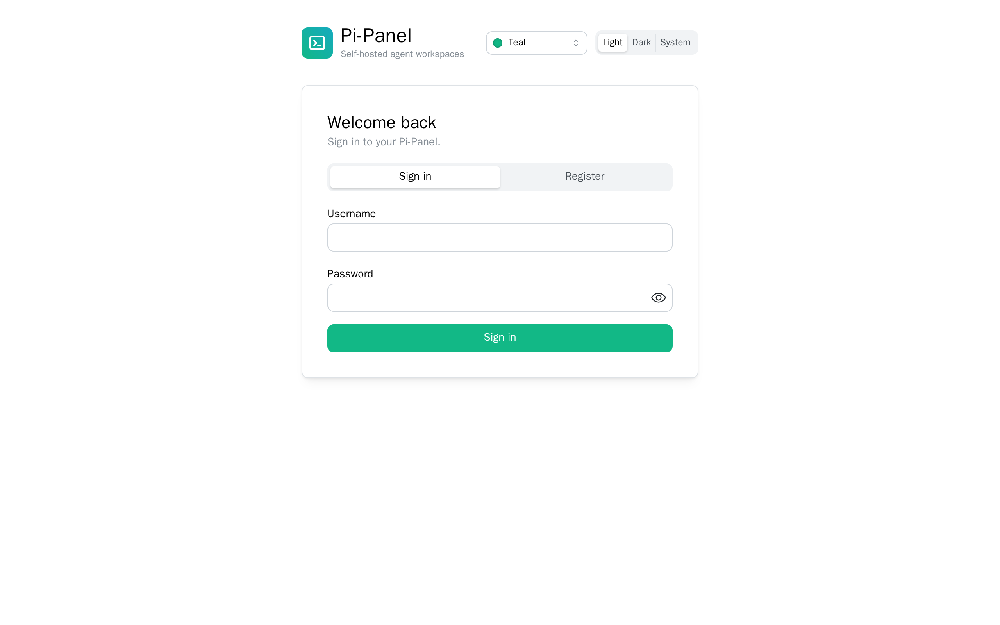
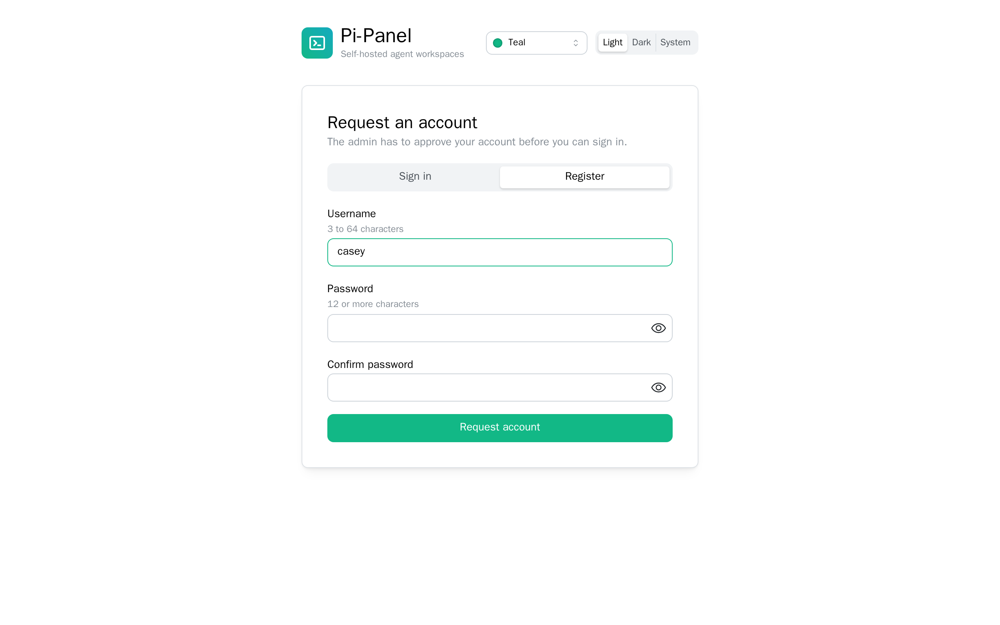
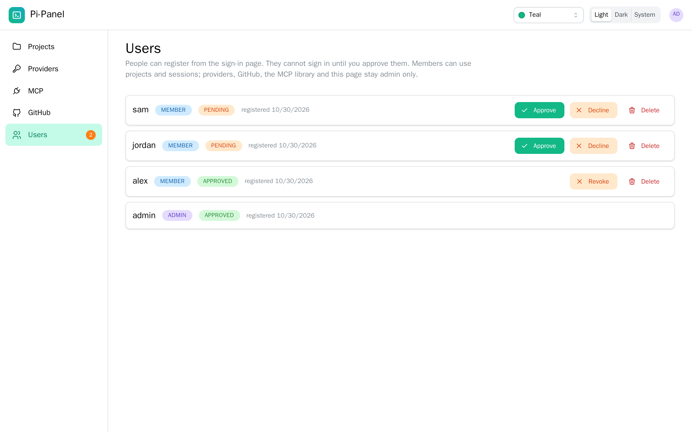
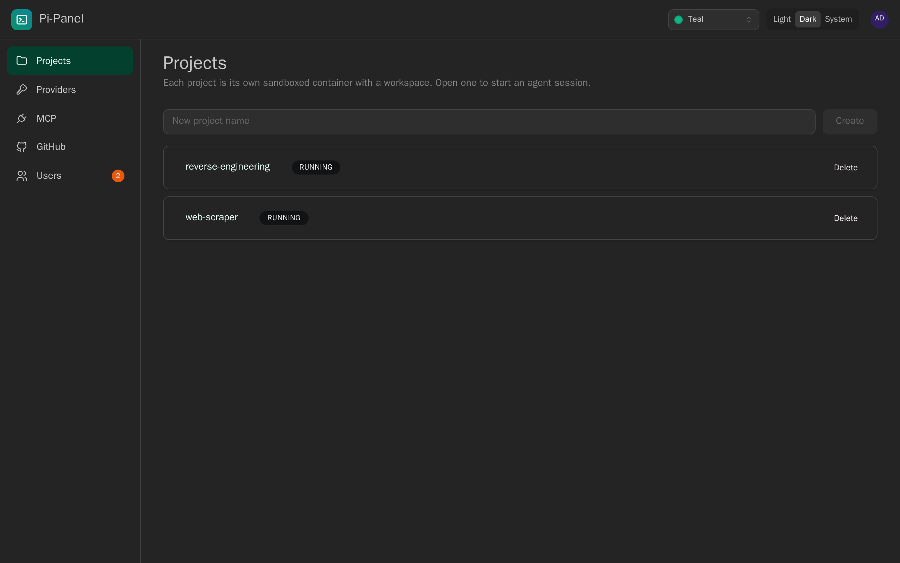
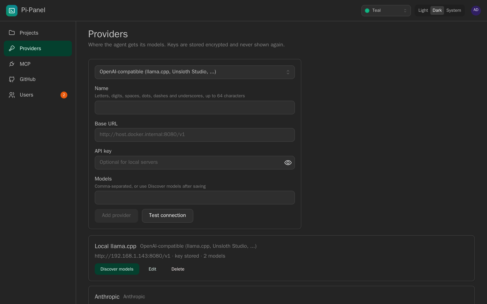
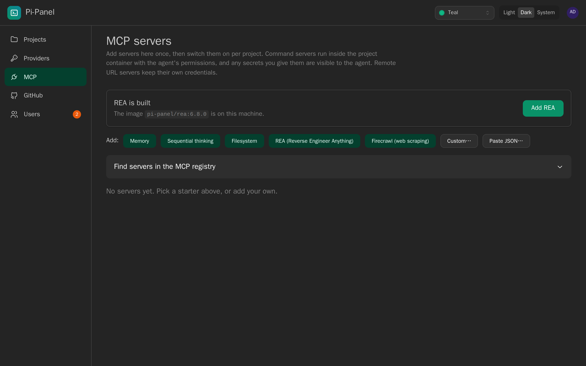

# Pi-Panel

A self-hosted web panel for running the [pi](https://pi.dev) coding agent in isolated, per-project Docker
containers. Create projects, talk to pi in live sessions, connect GitHub, manage providers, packages and
MCP servers, and build and test your own pi extensions, skills, prompts and themes, all from the browser.

> **Status: early.** Everything below was developed and tested against a fake container
> runtime and, where noted, against the real pi, real MCP servers and the real REA. The sandbox and panel
> images build and run under Docker Compose; networks, bind mounts and sidecars have not yet been run end
> to end. See [What has been verified](#what-has-been-verified) before relying on it.

## What it does

- **Projects and sessions.** One container per project with a bind-mounted workspace; pi runs inside it.
  Sessions stream live over WebSocket, persist their transcript, and resume. The terminal shows each
  tool call with its command and output, takes multi-line prompts, lets you steer or queue a follow-up
  while pi works, and exports the transcript as Markdown. A stopped or missing container is detected and
  can be started again, and **Recreate container** moves a project to a rebuilt sandbox image without
  losing files or history.
- **Providers.** Anthropic, OpenAI, and any OpenAI-compatible server (llama.cpp, Unsloth Studio, ...).
  Keys are encrypted at rest. _Test connection_ checks a provider's settings before you save them, and
  model lists are discovered from the provider.
- **GitHub.** Clone, commit, push and open pull requests with a personal access token. _Test token_ checks
  a token against GitHub before you connect it. Git runs in the panel, never in the sandbox, and the token
  never enters a container.
- **Pi packages.** Install npm pi packages per project, with an enforced review step that pins the exact
  version you looked at and disables install scripts.
- **Package lab.** Scaffold and test extensions, skills, prompts and themes in a throwaway container with
  no network and no credentials, using the real pi SDK.
- **MCP servers.** A library of servers with a checkbox per server per project and per tool. Command and
  URL servers, plus **managed containers** for servers that speak HTTP (such as
  [REA](https://github.com/morluto/rea)): isolated, on a private network, with uploadable samples. The
  MCP tab can build the REA image for you from a Ghidra download link and checksum.
- **Accounts.** The first account is the admin. Others can register from the sign-in page and cannot sign
  in until the admin approves them in the Users tab. Members work in projects and sessions; providers,
  GitHub, the MCP library and user management stay admin only. Projects, keys and tokens are still shared
  by everyone on the panel, so approve only people you trust.
- **Interface.** Light, dark or system colour scheme, a choice of accent colours, and tooltips on the main
  controls. Both are remembered per browser. Pages have their own URLs, so refresh and Back keep your
  place. The account menu has Change password and an About box with the panel and pi versions.

## Screenshots

<table>
  <tr>
    <td></td>
    <td></td>
  </tr>
  <tr>
    <td align="center"><sub>Sign in</sub></td>
    <td align="center"><sub>Request an account, approved by the admin</sub></td>
  </tr>
</table>


_Review registrations in the Users tab (light theme)._


_One sandboxed container per project (dark theme)._


_Providers, with Test connection and model discovery._


_MCP library with one-click starters and a registry search._

## Quick start (Docker)

Requires Docker with Compose, run from the repository root.

```bash
# 1. Build the sandbox image that project containers are created from
docker compose --profile build-only build sandbox-base

# 2. Build and start the panel
docker compose up -d --build

# 3. Open http://localhost:3000 and create the admin account
```

Data lives in `./data` (database, `secret.key`, workspaces, pi agent dirs, uploaded samples). **Back up
the database and `secret.key` together**: without the key the stored API keys cannot be decrypted.

The panel mounts the Docker socket so it can manage project containers. That is root-equivalent access to
the host: run it only on a machine and network you trust, and put it behind HTTPS (and add
`COOKIE_SECURE: 'true'` to the `pi-panel` service's `environment` in `docker-compose.yml`) if anyone
else can reach it.

Settings in `docker-compose.yml` (set the `PI_PANEL_*` variables in your shell or a `.env` file):

| Variable                                         | Default | What it does                                                                                                               |
| ------------------------------------------------ | ------- | -------------------------------------------------------------------------------------------------------------------------- |
| `PI_PANEL_TRUST_PROXY`                           | `false` | Behind a reverse proxy, `true` makes sign-in throttling see real client addresses. Only when the proxy is the only way in. |
| `PI_PANEL_SANDBOX_MEMORY_MB`                     | `2048`  | Memory limit for each project container.                                                                                   |
| `PI_PANEL_SANDBOX_CPUS`                          | `2`     | CPU limit for each project container.                                                                                      |
| `ALLOWED_ORIGINS` (in the service `environment`) | none    | Extra origins allowed to call the API, for proxies that rewrite the `Host` header.                                         |

Resource limits apply to containers created or recreated after you change them.

Optional: the REA reverse-engineering image needs a Ghidra release you choose and verify. In the MCP tab,
paste its download link and SHA-256 checksum and press **Build REA image**, or build it by hand (see
[docs/rea.md](docs/rea.md)).

## Development

Requires Node 22.19 or newer.

```bash
npm install
npm run dev:server   # API on :3000 (PI_PANEL_RUNTIME=fake runs without Docker)
npm run dev:web      # UI on :5173, proxying /api to the server

npm run format:check && npm run typecheck && npm run lint && npm test && npm run build
```

`PI_PANEL_RUNTIME=fake` swaps Docker for an in-memory runtime with a scripted fake pi, so the whole UI
works without containers.

### Tests against the real thing

Most tests use the fake runtime. A set of tests run the real pi SDK and CLI, a real MCP server and the
real REA, and are skipped unless you point them at installs (details in each doc):

| Tests                         | Needs                                       | Doc                                        |
| ----------------------------- | ------------------------------------------- | ------------------------------------------ |
| Package lab (`lab-real-pi`)   | `PI_SDK_ENTRY`                              | [docs/package-lab.md](docs/package-lab.md) |
| MCP discovery (`mcp-real-pi`) | `PI_SDK_ENTRY`, `PI_BIN`, `MCP_TEST_SERVER` | [docs/mcp.md](docs/mcp.md)                 |
| REA over HTTP (`rea-real`)    | the above plus `REA_NODE`, `REA_ENTRY`      | [docs/rea.md](docs/rea.md)                 |

## Layout

```
apps/server          Fastify + TypeScript API: auth, projects, sessions, providers, GitHub, packages, lab, MCP
apps/server/assets   scripts that run inside throwaway containers (package lab, MCP discovery)
apps/web             React, Mantine and Vite UI (served by the server in the production image)
docker/base          sandbox image: Node 24 + pi (pinned)
docker/rea           optional REA image: Node, JDK 21, Ghidra
docs/                design notes and how-tos
```

## Security model, briefly

- One admin account, created on first run. Sessions use HttpOnly, SameSite=Strict cookies. Failed
  sign-ins are limited per address (10 per 15 minutes), and expired sign-ins are purged.
- Writes and WebSocket connections must come from the panel's own origin. SameSite cookies alone do
  not stop another app on the same host (a different port) from using your session.
- Member restrictions are checked against the matched route, not the raw URL, so encoded paths cannot
  reach admin routes. Responses carry a Content-Security-Policy and anti-framing headers.
- Each project runs in its own container with dropped capabilities and resource limits. The agent runs
  with that container's permissions, so provider keys or command-server secrets passed to a session are
  visible to it. Prefer URL servers that hold their own credentials, or managed containers.
- Secrets (provider keys, GitHub token, MCP values) are AES-256-GCM encrypted at rest and never returned
  by the API. Generated pi config files contain `${VAR}` references, not values.
- Repository contents are treated as hostile: git runs with hooks disabled, a validated `.git`, an
  origin-scoped token and (as root) a dropped uid. A cloned repo's own `.pi` resources do not load.
- Throwaway runs (lab, MCP tests) copy files in as a tar archive and mount nothing from the host.
- Pi-Panel deliberately does not read secrets from environment variables or a `.env` file.

## What has been verified

| Area                                                                        | Verified how                                                   |
| --------------------------------------------------------------------------- | -------------------------------------------------------------- |
| API, sessions, providers, GitHub, packages, MCP, samples, sidecar lifecycle | Automated tests (fake runtime), including adversarial cases    |
| pi SDK harness, `pi mcp list --json`, generated `mcp.json`, hidden tools    | Real pi 1.4.0                                                  |
| MCP env passing, secret redaction, repo-local `.pi` not executing           | Real pi and a real MCP server                                  |
| REA catalog over HTTP (229 tools, 32 destructive hidden by default)         | Real REA 6.8.0 and real pi                                     |
| Web UI flows (before the Mantine redesign) and serving the built UI         | Driven in a real browser (Playwright) and with the real server |
| Sign-in, projects, sessions, routing, account menu (Mantine UI)             | Driven in headless Chromium against the fake runtime           |
| Container start/recreate and status tracking                                | Automated tests (fake runtime); not yet against real Docker    |
| **Docker: sandbox and panel images build; the panel container runs**        | **Built and started with Docker Compose on a real host**       |
| **Docker: networks, mounts, `exec`, sidecars, project sessions**            | **Not verified end to end**                                    |
| **Ghidra / JDK analysis inside the REA image**                              | **Not verified**                                               |

Expect to fix things on the first real run, and please report what breaks.

## Not built yet

Promoting lab packages to a shared toolbox, one-click pi upgrades (the About box shows the version;
upgrading is still a rebuild plus **Recreate container**), update checks for packages and MCP servers,
per-call approval prompts for risky tools, multi-user support, and a panel update notice. See
[docs/updates.md](docs/updates.md).

## Documentation

- [docs/pi-integration.md](docs/pi-integration.md): how Pi-Panel uses pi (RPC, config files, providers)
- [docs/github-integration.md](docs/github-integration.md): the GitHub threat model and behaviour
- [docs/packages-integration.md](docs/packages-integration.md): reviewed, pinned package installs
- [docs/package-lab.md](docs/package-lab.md): the lab, its isolation, and what a pass means
- [docs/mcp.md](docs/mcp.md): MCP library, per-project checkboxes, managed containers
- [docs/rea.md](docs/rea.md): running REA, what is isolated, what is verified
- [docs/updates.md](docs/updates.md): pinning, upgrading pi, what is not built

## License

MIT, see [LICENSE](LICENSE).
